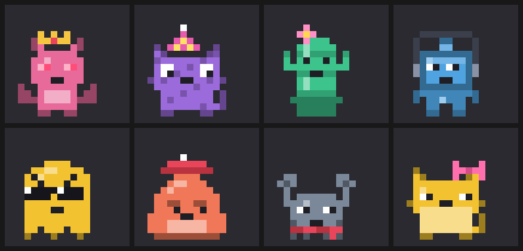
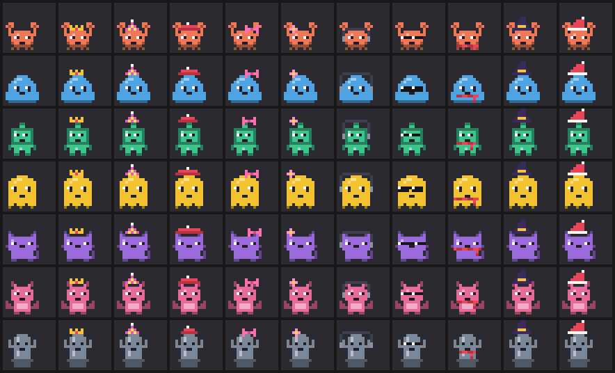
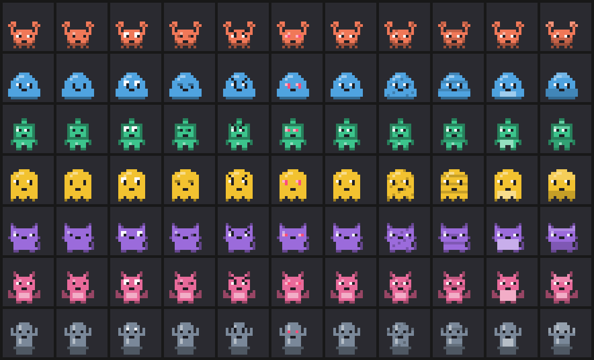
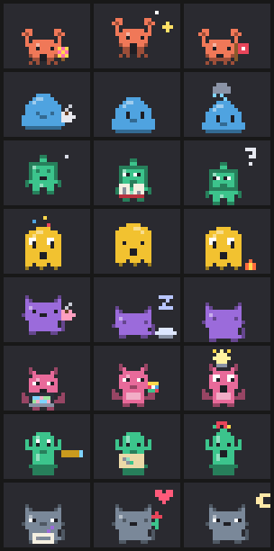
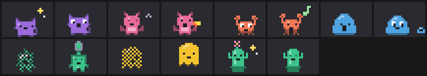
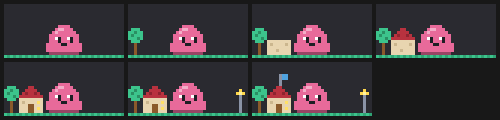
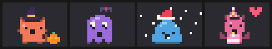

<p align="center">
  
</p>

<h1 align="center">Pixel Buddies</h1>

<p align="center">
  A tiny animated pixel-art companion with its own personality, living above your prompt in Claude Code.<br>
  Pick a type, a colour and a name. It reacts to your work, cheers your wins, sulks at errors, and thinks out loud.<br>
  It has a life of its own: it wanders, stretches, chases flies and does whatever its personality loves to do.<br>
  And it has a story: help it find the lost pixels of its shattered home world, and watch home rebuild on its stage.<br>
  Use it, earn achievements, and unlock new types, eyes, patterns and accessories.
</p>

<p align="center">
  <a href="https://github.com/karthikkay07/pixel-buddies/actions/workflows/ci.yml"></a>
  <a href="https://github.com/karthikkay07/pixel-buddies/releases"></a>
  <a href="LICENSE"></a>
</p>

<p align="center">
  <a href="#install">Install</a> ·
  <a href="#usage">Usage</a> ·
  <a href="#personalities">Personalities</a> ·
  <a href="#achievements">Achievements</a> ·
  <a href="#settings">Settings</a> ·
  <a href="#how-it-works">How it works</a> ·
  <a href="#development">Development</a> ·
  <a href="CHANGELOG.md">Changelog</a>
</p>

---

## Features

- **Buddy studio:** run `/buddy` to design a buddy: **type**, **colour**, **name** and **personality**, with a live preview of every animation.
- **A personality from its name:** "Captain Bolt" talks like a pirate, "Sleepy Mochi" yawns a lot, "Sprocket" quotes documentation. There are 8 archetypes, and you can reroll one or pick it yourself.
- **Reacts to your work:**
  - perks up when you send a prompt
  - bobs along while Claude works
  - celebrates passing tests and successful builds
  - wobbles sadly at errors
  - stretches after a long job
- **A story to play: *The Lost Pixels*.** Your buddy fell out of Pixelia, a little world inside an old game that shattered. Over 8 chapters, quests tied to your real work (passing tests, surviving errors, coming back tomorrow) rebuild its home **piece by piece, right on its stage**: grass, a tree, walls, a roof, a door, a lamp, a flag.
- **A wardrobe to earn:** 7 types, 6 eye styles, 5 patterns, 10 accessories (2 of them seasonal) and any colour you like. **19 achievements** from real use unlock them, and you can try on anything locked to see what you're working toward.
- **Random thoughts:** between tasks it thinks out loud ("💭 If a function is never called, does it truly exist?"), paced by its personality and your chattiness setting.
- **A life of its own:** between moments your buddy wanders around, looks about, stretches, yawns, sits, lies down and chases flies. It also has habits of its own: the pirate looks through a telescope, the grump sips coffee, the nerd types on a tiny laptop, the poet writes poems. That's **34 acts** and walking, picked by personality, energy and time of day.
- **Behaves like the creature it is:** cats groom and chase their tails, dragons puff smoke, crabs scuttle sideways, blobs split in two, robots glitch and recharge, ghosts fade away, cacti bloom.
- **Seasons and birthdays:** pumpkins, bats and a 🧙 witch hat at Halloween, snow and a 🎅 Santa hat in winter, and cake on your buddy's birthday every year.
- **Share it:** `/buddy card` saves an animated SVG card of your buddy and its home, ready for a README or a post.
- **Falls asleep when you're away** (Zzz…) and wakes up when you're back.
- **9 reaction animations:** idle, typing, thinking, happy, celebrate, sad, surprised, sleeping and wave, with floating effects (hearts, sparkles, sweat drops, Zzz, !, ?).
- **Real pixel art everywhere:** half-block cells repainted 8 times a second in the terminal, and a self-animating SVG in the Claude desktop app.
- **Private and offline:** no network calls and no model calls. Every line your buddy says is written into the mod, and nothing about your code leaves your machine.
- **Robust:** saved data is checked when it loads, and the buddy can never block a prompt or a tool call.

### The wardrobe

<p align="center"></p>

| Every type × every accessory | Eye styles, then patterns |
|---|---|
|  |  |

<details>
<summary>All 9 reaction animations</summary>


</details>

## Install

You need a build of [Claude Code](https://claude.com/claude-code) that supports mods (function-hook plugins). Pixel Buddies is tested on **2.1.295** and **2.1.303**. Mods are an early-access feature, so if `/plugin install` doesn't recognise the `--marketplace` flag, update Claude Code first.

From the prompt of a Claude Code terminal session, run:

```
/plugin install pixel-buddies --marketplace karthikkay07/pixel-buddies
```

1. Answer **`y`** to *Add marketplace?* (source `github:karthikkay07/pixel-buddies`).
2. Choose a scope. **User** (the default) turns Pixel Buddies on in every session.
3. Pick your settings (or keep the defaults).
4. You'll see `Installed pixel-buddies. Plugin is now active.` and a "No buddy yet. **Make one**" line above your prompt.

> **Claude desktop app:** `/plugin install` runs in a terminal session. Once it's installed at the user scope, Pixel Buddies also loads in the desktop app's Code tab and draws there as an animated SVG.

### Update

```bash
claude plugin update pixel-buddies
```

Then run `/reload-plugins` in any open session, or start a new one. Buddies made with 0.1 keep everything and get a personality read from their name.

### Uninstall

```bash
claude plugin uninstall pixel-buddies
```

## Usage

| Command | What it does |
|---|---|
| `/buddy` | Opens the **Buddy studio** panel |
| `/buddy story` | Opens *The Lost Pixels*: the chapter you're on, its quest, and home so far |
| `/buddy card` | Saves an animated SVG card of your buddy to your working folder, ready to share |
| `/buddy poke` | Pokes your buddy. It always reacts. |
| `/buddy achievements` | Lists every achievement with your progress and what it unlocks |
| `/buddy hide` | Hides your buddy (it's remembered) |
| `/buddy show` | Brings it back |

### In the studio

| Control | Key | Action |
|---|---|---|
| **Type** picker | arrows + Enter | Crab, Blob, Robot, Ghost, and 🔒 Cat, Dragon, Cactus |
| **Colour** picker | arrows + Enter | Seven preset colours |
| **Custom** field | type a hex, Enter | Any colour, like `#FF8800` (🔒 until *Artist*) |
| **Name** field | type, Enter to save | Up to 24 characters. Left empty, a name is picked for you. |
| **Personality** picker | arrows + Enter | *Auto (from the name)*, or one of the 8 archetypes |
| **Reroll** | `p` | Rolls a different personality for an *Auto* buddy |
| **Eyes** · **Pattern** · **Accessory** pickers | arrows + Enter | Dress your buddy up (🔒 marks what's still locked) |
| **Preview** picker | arrows + Enter | Plays any reaction, act, walking or working in the preview |
| **Save buddy / Save changes** | `s` | Saves and makes it your active buddy (it says hello) |
| **Save as new** | `n` | Keeps the current buddy and adds this design as a new one |
| **Surprise me** | `r` | Random type, colour, name, personality and style, from what you've unlocked |
| **Use / Delete** | — | Manage your roster at the bottom of the panel |

The studio shows the personality as you type the name: its archetype, energy, chattiness, traits and a sample line. **Locked items can be tried on:** pick one and the preview wears it, but saving tells you what to do to unlock it. Your achievements and progress are listed at the bottom. You can keep up to 50 buddies. Press **Esc** to close the studio.

## Personalities

| Archetype | Energy | Chatty | Traits | Names that suggest it |
|---|---|---|---|---|
| **Cheerleader** | ●●●●● | ●●●●○ | believes in you, loudly · celebrates every tiny win | Sunny, Joy, Sparkle, Star |
| **Grump** | ●●○○○ | ●●●○○ | unimpressed by everything · secretly cares a lot | Grumpy, Grim, Oscar, Rusty |
| **Philosopher** | ●○○○○ | ●●●○○ | ponders the nature of bugs · speaks in gentle riddles | Sage, Zen, Socrates, Owl |
| **Chaos gremlin** | ●●●●● | ●●●●● | wants to press the red button · chaotic but kind | Chaos, Gremlin, Zig, Boom |
| **Sleepy** | ●○○○○ | ●●○○○ | always five minutes from a nap · cosy | Sleepy, Mochi, Nap, Luna |
| **Nerd** | ●●●○○ | ●●●●○ | quotes documentation for fun · owns a label maker | Pixel, Bit, Sprocket, Ada |
| **Pirate** | ●●●●○ | ●●●●○ | calls bugs "scallywags" · arr | Captain, Jack, Salty, Anchor |
| **Poet** | ●●○○○ | ●●●○○ | speaks in tiny poems · dramatic about errors | Willow, Rose, Byron, Ivy |

With *Auto*, the first word of the name that matches a keyword decides ("Captain Bolt" is a pirate). Otherwise the name's hash picks one, so the same name always gives the same buddy. Energy and chattiness vary by ±1 between buddies of the same archetype.

### What your buddy reacts to

| When… | It… |
|---|---|
| a session starts, or you save or switch buddies | waves hello |
| you send a prompt | perks up (!) |
| Claude is working | bobs along, typing |
| a tool call fails | wobbles, with a sweat drop (at most once every 20 s) |
| tests pass or a build succeeds (in Bash output) | celebrates with sparkles |
| a turn that took 45 s or more finishes | hops happily (♥) |
| nothing happens for a while | thinks out loud (💭) |
| you're away past the sleep timer | falls asleep (Zzz) and wakes up when you're back |

## A life of its own

Your buddy doesn't just bob in place. Every so often it does something of its own: a few seconds of a habit, then a rest, then something else. An energetic buddy is up to something every ~10 s, a calm one every ~40 s, and it never repeats its last few acts.

<p align="center"></p>

| Personality | Its habits | While Claude works |
|---|---|---|
| **Cheerleader** | shakes pom-poms · jumping jacks · waves a flag | pom-poms |
| **Grump** | sips coffee · taps a foot · sulks under a rain cloud | coffee |
| **Philosopher** | meditates, floating · reads a book · ponders (?) | book |
| **Chaos gremlin** | juggles · spins · starts a tiny fire, then stomps it out | juggling |
| **Sleepy** | sips cocoa · naps on a pillow · nods off | cocoa |
| **Nerd** | types on a laptop · solves a cube · has an idea (💡) | laptop |
| **Pirate** | looks through a telescope · reads a treasure map · a parrot drops by | treasure map |
| **Poet** | writes a poem · smells a rose · gazes at the moon | quill |

**Every type** has habits of its own, too:

<p align="center"></p>

| Type | Habits |
|---|---|
| **Cat** | grooms · chases its tail, then sits down dizzy |
| **Dragon** | puffs smoke · breathes a tiny flame |
| **Crab** | scuttles sideways · clacks its claws |
| **Blob** | jiggles · splits off a mini-me, which wanders back |
| **Robot** | glitches · recharges its battery |
| **Ghost** | fades away · floats in loops |
| **Cactus** | blooms a flower · sways in the breeze |

**Every buddy** also looks around, turns around, stretches, yawns, shivers, sneezes, scratches an itch, sits down, lies down, chases a fly and **wanders** across its stage, facing the way it walks.

**The moment matters:** mornings bring stretches and coffee, late nights bring yawns, naps and moon-gazing, and a grump that just saw an error is much likelier to sulk under its cloud. Reactions (wins, errors, prompts) always cut in, and while Claude works your buddy works too, holding its personality's prop.

## The Lost Pixels

*Your buddy tumbles out of a crack in the screen and dusts itself off. "I'm from Pixelia," it says, "a little world inside an old game. It shattered, and its pixels scattered into the code all around us. Will you help me find them?"*

The story is told in 8 short chapters. Each opens with a beat of story (shown as a toast and in `/buddy story`) and a **quest from your real work**. Finish the quest and the chapter ends: your buddy celebrates, and **a piece of its home comes back on its stage**.

<p align="center"></p>

| Chapter | Quest | Brings back |
|---|---|---|
| 1. A pixel falls | Send 5 prompts | Grass |
| 2. The first spark | Pass tests or a build 2 times | A tree |
| 3. Map fragments | Use Claude Code on 2 more days | Walls |
| 4. The Bug Swamp | Survive 5 errors | The roof |
| 5. A friend's knock | Poke your buddy 5 times | A door and a lit window |
| 6. The long night | Finish 3 long jobs | A lamp post |
| 7. Raise the flag | Watch Claude run 60 tools | A flag on the roof |
| 8. Who's out there? | Come back on 3 more days | *To be continued…* |

Quests count from the moment their chapter begins. Your buddy sometimes thinks about the current one ("💭 2 more green test runs and the pixels will light up…"). The home is drawn behind your buddy everywhere it appears: above the prompt, in the studio, and on your card. The story is shared by all your buddies; it's your journey together.

## Seasons and birthdays

<p align="center"></p>

- **Halloween** (15 October to 2 November): buddies carve pumpkins, watch bats flit past and say *boo*. Using Claude Code during Halloween earns 🏆 **Spooky season** and the 🧙 **Witch hat**, yours to keep.
- **Winter** (1 December to 6 January): buddies catch snowflakes. A winter day earns 🏆 **Frosty** and the 🎅 **Santa hat**.
- **Birthdays:** each buddy remembers the day you made it. Every year on that day you get a 🎂 toast, a happy hop and birthday cake. Buddies made before 0.5 count from the day they first saw 0.5.

## Share your buddy

`/buddy card` saves `pixel-buddy-<name>.svg` in your working folder: an animated card with your buddy waving in front of its home, its name and personality, days together, achievements and story chapter. Drop it into a README:

```markdown

```

## Achievements

You start with the 4 original types, 7 colours, classic eyes, a plain pattern and no accessory. Everything else is earned by using Claude Code with your buddy:

| Achievement | Goal | Unlocks |
|---|---|---|
| 🏆 **Hello, friend** | Make your first buddy | Dots eyes, Belly pattern |
| 🏆 **Chatterbox** | Send 25 prompts | Spots pattern |
| 🏆 **Green light** | Pass tests or a build 3 times | Party hat |
| 🏆 **Best friends** | Poke your buddy 10 times | Love eyes |
| 🏆 **Collector** | Make 3 buddies | Bow |
| 🏆 **Regular** | Use Claude Code on 3 different days | Cat |
| 🏆 **Cosy** | Start 10 sessions | Scarf |
| 🏆 **Bounce back** | Survive 10 errors | Angry eyes |
| 🏆 **Deep thinker** | Hear 15 random thoughts | Big & shiny eyes |
| 🏆 **Hard worker** | Watch Claude run 100 tools | Headphones |
| 🏆 **Marathon** | Finish 5 long jobs (45 s or more) | Stripes pattern |
| 🏆 **Artist** | Use Claude Code on 5 different days | Custom colour |
| 🏆 **Night owl** | Send 10 prompts between midnight and 5 am | Sleepy eyes, Beanie |
| 🏆 **Green thumb** | Send 100 prompts | Cactus, Flower |
| 🏆 **Devoted** | Use Claude Code on 7 different days | Dragon, Gradient pattern |
| 🏆 **Champion** | Pass tests or a build 25 times | Crown |
| 🏆 **Cool customer** | Watch Claude run 500 tools | Shades |
| 🏆 **Spooky season** | Use Claude Code during Halloween (15 Oct to 2 Nov) | Witch hat |
| 🏆 **Frosty** | Use Claude Code in winter (1 Dec to 6 Jan) | Santa hat |

When you earn one, a toast says what you unlocked and your buddy celebrates. Run `/buddy achievements` or open the studio to see your progress.

Only **counts** are kept (how many prompts, tool calls, wins and so on, plus the last day you were active), in the mod's own store on your machine. Nothing about what you typed or what Claude did is saved. Buddies made before 0.3 count toward *Hello, friend* and *Collector*.

## Settings

Change these from Claude Code's config menu (`/config` in a terminal session), or in `settings.json` under `pluginConfigs["pixel-buddies"].options`.

| Setting | Values | Default | Effect |
|---|---|---|---|
| `chattiness` | `silent` · `quiet` · `normal` · `chaotic` | `normal` | **silent**: animations only. **quiet**: speaks at big moments, thinks about every 10 min. **normal**: reacts to prompts sometimes, thinks every few minutes. **chaotic**: comments on nearly everything and thinks about every minute. |
| `sleepAfterMinutes` | number | `10` | Minutes without activity before your buddy dozes off. `0` keeps it awake. |

A buddy's own chattiness scales how often it thinks: a chaos gremlin muses two to three times as often as a sleepy buddy. Small remarks have a cooldown, so even a chaotic buddy doesn't flood the band.

## How it works

Pixel Buddies is a **mod**: a TypeScript hooks module that Claude Code loads in its own sandbox. It has no DOM, no Node and no network access.

| Piece | Mod API |
|---|---|
| `/buddy` command | `$.command.register` + a `command.run` hook |
| Studio panel | `$.ui.open` + a `ui.render` hook for `Pane`, using `Select`, `Input` and `Button` elements |
| Buddy above the prompt | a `ui.render` hook for `AbovePrompt` |
| Reactions | `prompt.submit`, `tool.call` (the result after `next`) and `turn.complete` hooks. Each has a pass-through `.catch`, so a buddy can never block your work. |
| Thoughts and sleep | a `$.clock.every` "brain" tick every 10 s |
| Acts and wandering | a `$.clock.after` loop: rest, pick an act from [`hooks/acts.ts`](hooks/acts.ts) (by personality, energy, hour and recent errors), play it, rest again |
| Terminal animation | a 40 × 9 `Raster` stage repainted in place by `$.ui.blit` every 125 ms |
| Desktop animation | an `Svg` element: each distinct picture of the buddy is drawn once in `<defs>` and shown in turn by `<use x=…>` with SMIL `<animate>`, so a walk across the stage is two pictures and no timers |
| Saved buddies | `$.store`, checked on load by [`hooks/data.ts`](hooks/data.ts) |
| Live state | `atom` / `read` / `update` over `$.state` (`mood`, `isAsleep`, `stats`, `earned`, …), so a change redraws whatever reads it |
| Achievements | counts bumped from the same hooks, checked against [`hooks/achievements.ts`](hooks/achievements.ts), saved to `$.store` on the brain tick and at `session.end` |
| The story | each count also checks the open chapter's quest in [`hooks/story.ts`](hooks/story.ts); finishing one advances `story` in `$.store`, and [`hooks/scenery.ts`](hooks/scenery.ts) draws the home built so far behind the buddy (once in the SVG, under the moving frames) |
| Seasons and birthdays | [`hooks/seasons.ts`](hooks/seasons.ts) gates seasonal acts and counts seasonal days; a birthday is checked once a day at session start |
| Share card | [`hooks/card.ts`](hooks/card.ts) builds a self-contained SVG, written with `$.fs.write` |
| Settings | `userConfig` in `plugin.json`, read from `register(on, options)` |

Sprites are 12×12 strings in [`hooks/sprites.ts`](hooks/sprites.ts). Each letter is a role (`B` body, `D` shade, `L` highlight, `E` eye, `W` eye shine, `K` mouth), so one drawing works in every colour and every expression. An animation in [`hooks/animations.ts`](hooks/animations.ts) is a function from tick to **pose**: offset, eyes (`open`, `closed`, `happy`, `wide`, `sad`), mouth (`smile`, `open`, `flat`, `none`) and an effect. The renderer turns any pose of any sprite into pixels. A **look** (type, colour and style) is layered on top: patterns recolour body pixels, eye styles recolour the eyes and add shine or brows, and accessories are stamped at **anchors** read from the sprite's letters (eyes, head top, mouth), so a new type wears every accessory with no extra numbers. See [`hooks/style.ts`](hooks/style.ts). Personalities, lines and reaction rules live in [`hooks/personality.ts`](hooks/personality.ts).

## Development

```bash
git clone https://github.com/karthikkay07/pixel-buddies
cd pixel-buddies
claude --plugin-dir .
```

The `--plugin-dir` flag hot-reloads the mod every time you save a file.

```bash
claude plugin validate .
```

```bash
claude plugin test .
```

`validate` checks the manifest, the marketplace file and the hooks module the way the engine will load them. `test` runs 68 tests in ten suites:

| Suite | Covers |
|---|---|
| [`tests/buddy.test.tsx`](tests/buddy.test.tsx) | Sprite data, every animation × type in the terminal and as SVG, poses, and the studio → save → band flow on `terminal` and `desktop` |
| [`tests/personality.test.ts`](tests/personality.test.ts) | Lines for every archetype and event, name → personality, rerolls, chattiness levels, no-repeat lines, thought pacing, reading tool results |
| [`tests/acts.test.ts`](tests/acts.test.ts) | Every act on every type (terminal and SVG size), every prop on the stage, walks, picking by personality, energy, night and errors, rest times |
| [`tests/mood.test.tsx`](tests/mood.test.tsx) | Hello on session start, poke, falling asleep and waking, silent mode, acts happening on their own, the working prop (on the mock clock) |
| [`tests/lifecycle.test.tsx`](tests/lifecycle.test.tsx) | Restoring from a partly broken store, `/buddy hide` and `show`, switching, Save as new, Delete |
| [`tests/achievements.test.ts`](tests/achievements.test.ts) | Every item free or earned by exactly one achievement, progress, unlocking, day counting, accessory anchors on every type |
| [`tests/unlocks.test.tsx`](tests/unlocks.test.tsx) | Trying on locked items and being stopped at save, earning *Best friends* by poking and saving love eyes, custom colours after *Artist* |
| [`tests/story.test.ts`](tests/story.test.ts) | Chapters and quests, home growing piece by piece, season dates, birthdays, quirks by type and seasonal acts by season, the card (escaping, file names, days together) |
| [`tests/journey.test.tsx`](tests/journey.test.tsx) | The story told and its first quest finished by real prompts, the story pane, `/buddy card` writing its file, a birthday toast, Halloween's witch hat, birthdays for older buddies |
| [`tests/data.test.ts`](tests/data.test.ts) | Store checks: buddies, styles, stats, earned achievements and the story, including upgrades from earlier versions |

[CI](.github/workflows/ci.yml) runs both commands on Ubuntu and Windows for every push and pull request, pinned to a known Claude Code version.

For editor type-checking, load the mod once (Claude Code writes its typings to `.claude-plugin/types/`), then run `tsc -p .`.

### Add a new buddy type

1. Draw a 12×12 sprite in `SPRITES` in `hooks/sprites.ts`, using the letters above. Mark eyes with `E` (and `W` for shine) and the mouth with `K`, so every expression, eye style and accessory works.
2. Add it to `KINDS` there and to `BuddyKind` in `types/index.d.ts`.
3. Make it free (`FREE`) or a reward of an achievement in `hooks/achievements.ts`.
4. Run `claude plugin test .`. The tests draw every animation and accessory for it, and check that it's unlockable.

### Add an act

1. Add it to `UNIVERSAL` or `SIGNATURE` in `hooks/acts.ts` with `act(id, label, weight, steps, { who, when })`. Each step holds a pose (eyes, mouth, look, squash, flip, offset, effect, prop) for some ticks of 125 ms.
2. Give it a phrase in `DOING` ("is juggling") for the band.
3. Need a new prop? Draw it in `PROPS` in `hooks/props.ts` with an anchor: `hand`, `front`, `above`, `perch`, `ground` or `free`.
4. Run `claude plugin test .`. The tests draw it on every type and check it fits the stage.

### Add a personality

1. Add an entry to `ARCHETYPES` in `hooks/personality.ts`: label, energy, chattiness, three traits, name keywords, and lines for each event (`{name}`, `{tool}` and `{time}` are filled in).
2. Add it to `Archetype` in `types/index.d.ts`.
3. Give it three signature acts in `hooks/acts.ts` and a prop in `WORK_PROP`.
4. Run `claude plugin test .`. The tests check every event has lines, that they're short enough, and that the personality has its three acts.

### Layout

```
.claude-plugin/
  plugin.json        manifest and settings (userConfig)
  marketplace.json   makes this repo installable with /plugin install
hooks/
  hooks.json         points at register.tsx
  register.tsx       commands, studio, band, reactions, brain and paint timers
  personality.ts     archetypes, lines, name → personality, reaction rules
  animations.ts      the 9 animations as tick → pose
  sprites.ts         pixel data, effects, Raster and SVG encoders
  style.ts           eye styles, patterns, accessories, sprite anchors
  achievements.ts    the 19 achievements, unlocks and stat counting
  acts.ts            the 53 acts, walking, and picking what to do next
  story.ts           The Lost Pixels: chapters, quests, progress
  scenery.ts         Pixelia's home, piece by piece
  seasons.ts         seasons and birthdays
  card.ts            the shareable SVG card
  props.ts           the props buddies hold and play with
  color.ts           palette maths
  data.ts            checks for saved data
types/index.d.ts     the mod's $.state contract
tests/               claude plugin test suites
.github/workflows/   CI: validate + test on Ubuntu and Windows
assets/              README images
```

## Roadmap

- **v0.6:** the story continues: the light on the horizon is another lost buddy. Visits and friendship on the stage, growing up (baby, teen, adult forms), git-aware reactions.
- **v0.7 (opt-in AI):** a richer personality written by Claude when you create a buddy, `/buddy ask`, rate-limited live quips. Only the buddy's profile and an event label are ever sent.
- **v1.0:** memory and stats ("Day 12 together!"), an optional "speak through Claude" mode, sounds

Issues and pull requests are welcome.

## License

[MIT](LICENSE) © karthikkay07. Pixel Buddies is an independent community project and isn't affiliated with Anthropic.
