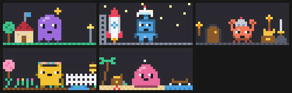

<p align="center">
  
</p>

<h1 align="center">Pixel Buddies</h1>

<p align="center">
  A tiny animated pixel-art companion with its own personality, living above your prompt in Claude Code.<br>
  Pick a type, a colour and a name. It reacts to your work, cheers your wins, sulks at errors, and thinks out loud.<br>
  It has a life of its own: it wanders, stretches, chases flies and does whatever its personality loves to do.<br>
  And it has stories: pick an adventure (rebuild a lost world, fly a rocket home, beat the Bug King, grow a garden, find sunken treasure) and watch its world build up on its stage as you work.<br>
  Use it, earn achievements, and unlock new types, eyes, patterns and accessories.
</p>

<p align="center">
  <a href="https://github.com/karthikkay07/pixel-buddies/actions/workflows/ci.yml"></a>
  <a href="https://github.com/karthikkay07/pixel-buddies/releases"></a>
  <a href="LICENSE"></a>
</p>

<p align="center">
  <a href="#install">Install</a> ·
  <a href="#usage">Usage</a> ·
  <a href="#personalities">Personalities</a> ·
  <a href="#achievements">Achievements</a> ·
  <a href="#settings">Settings</a> ·
  <a href="#how-it-works">How it works</a> ·
  <a href="#development">Development</a> ·
  <a href="CHANGELOG.md">Changelog</a>
</p>

---

## Features

- **Buddy studio:** run `/buddy` to design a buddy: **type**, **colour**, **name** and **personality**, with a live preview of every animation.
- **A personality from its name:** "Captain Bolt" talks like a pirate, "Sleepy Mochi" yawns a lot, "Sprocket" quotes documentation. There are 8 archetypes, and you can reroll one or pick it yourself.
- **Reacts to your work:**
  - perks up when you send a prompt
  - bobs along while Claude works
  - celebrates passing tests and successful builds
  - wobbles sadly at errors
  - stretches after a long job
- **Five stories, acted out on stage:** 🏠 *The Lost Pixels*, 🚀 *Star Voyager*, ⚔️ *The Bug King*, 🌱 *Code Garden* and 🏴‍☠️ *The Sunken Repo*. Each buddy plays **its own** adventure: 8 chapters of quests tied to your real work (passing tests, surviving errors, coming back tomorrow) that build its world **piece by piece, right on its stage**. Meanwhile your buddy walks over and **works on it**: hammering, welding, sword-fighting, watering, digging. Finish one for a trophy and a hat to match.
- **A wardrobe to earn:** 7 types, 6 eye styles, 5 patterns, 15 accessories and any colour you like. Most of it unlocks **as you finish story chapters**, the rest through a short shelf of **11 milestone achievements**. You can try on anything locked to see what you're working toward.
- **Random thoughts:** between tasks it thinks out loud ("💭 If a function is never called, does it truly exist?"), paced by its personality and your chattiness setting.
- **A life of its own:** between moments your buddy wanders around, looks about, stretches, yawns, sits, lies down and chases flies. It also has habits of its own: the pirate looks through a telescope, the grump sips coffee, the nerd types on a tiny laptop, the poet writes poems. That's **34 acts** and walking, picked by personality, energy and time of day.
- **Behaves like the creature it is:** cats groom and chase their tails, dragons puff smoke, crabs scuttle sideways, blobs split in two, robots glitch and recharge, ghosts fade away, cacti bloom.
- **Seasons and birthdays:** pumpkins, bats and a 🧙 witch hat at Halloween, snow and a 🎅 Santa hat in winter, and cake on your buddy's birthday every year.
- **Share it:** `/buddy card` saves an animated SVG card of your buddy and its home, ready for a README or a post.
- **Falls asleep when you're away** (Zzz…) and wakes up when you're back.
- **9 reaction animations:** idle, typing, thinking, happy, celebrate, sad, surprised, sleeping and wave, with floating effects (hearts, sparkles, sweat drops, Zzz, !, ?).
- **Real pixel art everywhere:** half-block cells repainted 8 times a second in the terminal, and a self-animating SVG in the Claude desktop app.
- **Private and offline:** no network calls and no model calls. Every line your buddy says is written into the mod, and nothing about your code leaves your machine.
- **Robust:** saved data is checked when it loads, and the buddy can never block a prompt or a tool call.

### The wardrobe

<p align="center"></p>

| Every type × every accessory | Eye styles, then patterns |
|---|---|
|  |  |

<details>
<summary>All 9 reaction animations</summary>


</details>

## Install

You need a build of [Claude Code](https://claude.com/claude-code) that supports mods (function-hook plugins). Pixel Buddies is tested on **2.1.295** and **2.1.303**. Mods are an early-access feature, so if `/plugin install` doesn't recognise the `--marketplace` flag, update Claude Code first.

From the prompt of a Claude Code terminal session, run:

```
/plugin install pixel-buddies --marketplace karthikkay07/pixel-buddies
```

1. Answer **`y`** to *Add marketplace?* (source `github:karthikkay07/pixel-buddies`).
2. Choose a scope. **User** (the default) turns Pixel Buddies on in every session.
3. Pick your settings (or keep the defaults).
4. You'll see `Installed pixel-buddies. Plugin is now active.` and a "No buddy yet. **Make one**" line above your prompt.

> **Claude desktop app:** `/plugin install` runs in a terminal session. Once it's installed at the user scope, Pixel Buddies also loads in the desktop app's Code tab and draws there as an animated SVG.

### Update

```bash
claude plugin update pixel-buddies
```

Then run `/reload-plugins` in any open session, or start a new one. Buddies made with 0.1 keep everything and get a personality read from their name.

### Uninstall

```bash
claude plugin uninstall pixel-buddies
```

## Usage

| Command | What it does |
|---|---|
| `/buddy` | Opens the **Buddy studio** panel |
| `/buddy story` | Opens your buddy's story (the chapter, its quest and its world so far) and lets you switch to another |
| `/buddy card` | Saves an animated SVG card of your buddy to your working folder, ready to share |
| `/buddy poke` | Pokes your buddy. It always reacts. |
| `/buddy achievements` | Your milestones and story rewards, with progress and what each unlocks |
| `/buddy hide` | Hides your buddy (it's remembered) |
| `/buddy show` | Brings it back |

### In the studio

| Control | Key | Action |
|---|---|---|
| **Type** picker | arrows + Enter | Crab, Blob, Robot, Ghost, and 🔒 Cat, Dragon, Cactus |
| **Colour** picker | arrows + Enter | Seven preset colours |
| **Custom** field | type a hex, Enter | Any colour, like `#FF8800` (🔒 until *Artist*) |
| **Name** field | type, Enter to save | Up to 24 characters. Left empty, a name is picked for you. |
| **Personality** picker | arrows + Enter | *Auto (from the name)*, or one of the 8 archetypes |
| **Reroll** | `p` | Rolls a different personality for an *Auto* buddy |
| **Eyes** · **Pattern** · **Accessory** pickers | arrows + Enter | Dress your buddy up (🔒 marks what's still locked) |
| **Preview** picker | arrows + Enter | Plays any reaction, act, walking or working in the preview |
| **Save buddy / Save changes** | `s` | Saves and makes it your active buddy (it says hello) |
| **Save as new** | `n` | Keeps the current buddy and adds this design as a new one |
| **Surprise me** | `r` | Random type, colour, name, personality and style, from what you've unlocked |
| **Use / Delete** | — | Manage your roster at the bottom of the panel |

The studio shows the personality as you type the name: its archetype, energy, chattiness, traits and a sample line. **Locked items can be tried on:** pick one and the preview wears it, but saving tells you what to do to unlock it. Your next story reward and your achievements are listed at the bottom. You can keep up to 50 buddies. Press **Esc** to close the studio.

## Personalities

| Archetype | Energy | Chatty | Traits | Names that suggest it |
|---|---|---|---|---|
| **Cheerleader** | ●●●●● | ●●●●○ | believes in you, loudly · celebrates every tiny win | Sunny, Joy, Sparkle, Star |
| **Grump** | ●●○○○ | ●●●○○ | unimpressed by everything · secretly cares a lot | Grumpy, Grim, Oscar, Rusty |
| **Philosopher** | ●○○○○ | ●●●○○ | ponders the nature of bugs · speaks in gentle riddles | Sage, Zen, Socrates, Owl |
| **Chaos gremlin** | ●●●●● | ●●●●● | wants to press the red button · chaotic but kind | Chaos, Gremlin, Zig, Boom |
| **Sleepy** | ●○○○○ | ●●○○○ | always five minutes from a nap · cosy | Sleepy, Mochi, Nap, Luna |
| **Nerd** | ●●●○○ | ●●●●○ | quotes documentation for fun · owns a label maker | Pixel, Bit, Sprocket, Ada |
| **Pirate** | ●●●●○ | ●●●●○ | calls bugs "scallywags" · arr | Captain, Jack, Salty, Anchor |
| **Poet** | ●●○○○ | ●●●○○ | speaks in tiny poems · dramatic about errors | Willow, Rose, Byron, Ivy |

With *Auto*, the first word of the name that matches a keyword decides ("Captain Bolt" is a pirate). Otherwise the name's hash picks one, so the same name always gives the same buddy. Energy and chattiness vary by ±1 between buddies of the same archetype.

### What your buddy reacts to

| When… | It… |
|---|---|
| a session starts, or you save or switch buddies | waves hello |
| you send a prompt | perks up (!) |
| Claude is working | bobs along, typing |
| a tool call fails | wobbles, with a sweat drop (at most once every 20 s) |
| tests pass or a build succeeds (in Bash output) | celebrates with sparkles |
| a turn that took 45 s or more finishes | hops happily (♥) |
| nothing happens for a while | thinks out loud (💭) |
| you're away past the sleep timer | falls asleep (Zzz) and wakes up when you're back |

## A life of its own

Your buddy doesn't just bob in place. Every so often it does something of its own: a few seconds of a habit, then a rest, then something else. An energetic buddy is up to something every ~10 s, a calm one every ~40 s, and it never repeats its last few acts.

<p align="center"></p>

| Personality | Its habits | While Claude works |
|---|---|---|
| **Cheerleader** | shakes pom-poms · jumping jacks · waves a flag | pom-poms |
| **Grump** | sips coffee · taps a foot · sulks under a rain cloud | coffee |
| **Philosopher** | meditates, floating · reads a book · ponders (?) | book |
| **Chaos gremlin** | juggles · spins · starts a tiny fire, then stomps it out | juggling |
| **Sleepy** | sips cocoa · naps on a pillow · nods off | cocoa |
| **Nerd** | types on a laptop · solves a cube · has an idea (💡) | laptop |
| **Pirate** | looks through a telescope · reads a treasure map · a parrot drops by | treasure map |
| **Poet** | writes a poem · smells a rose · gazes at the moon | quill |

**Every type** has habits of its own, too:

<p align="center"></p>

| Type | Habits |
|---|---|
| **Cat** | grooms · chases its tail, then sits down dizzy |
| **Dragon** | puffs smoke · breathes a tiny flame |
| **Crab** | scuttles sideways · clacks its claws |
| **Blob** | jiggles · splits off a mini-me, which wanders back |
| **Robot** | glitches · recharges its battery |
| **Ghost** | fades away · floats in loops |
| **Cactus** | blooms a flower · sways in the breeze |

**Every buddy** also looks around, turns around, stretches, yawns, shivers, sneezes, scratches an itch, sits down, lies down, chases a fly and **wanders** across its stage, facing the way it walks.

**The moment matters:** mornings bring stretches and coffee, late nights bring yawns, naps and moon-gazing, and a grump that just saw an error is much likelier to sulk under its cloud. Reactions (wins, errors, prompts) always cut in, and while Claude works your buddy works too, holding its personality's prop.

## Stories

Every buddy lives its own adventure, and **acts it out right above your prompt**. A new buddy starts the story that suits its personality (a pirate sets sail on *The Sunken Repo*, a nerd starts building a rocket). Switch to any other story in `/buddy story`.

<p align="center"></p>

| Story | The premise | Its world | Suits | Finish reward |
|---|---|---|---|---|
| 🏠 **The Lost Pixels** | Your buddy fell out of Pixelia, a shattered game world. Find its lost pixels and rebuild its home. | grass, tree, walls, roof, door, lamp, flag | everyone | 🏆 *Home again* · Pixel star |
| 🚀 **Star Voyager** | Crash-landed in your terminal, your buddy builds a rocket to fly back to the stars. | launch pad and stars, scaffold, hull, nose cone, fins, porthole, engine flame | nerd, philosopher | 🏆 *Liftoff!* · Space helmet |
| ⚔️ **The Bug King** | Deep beneath your code, the Bug King sends bugs into the world. Brave his dungeon. | stone floor, torches, door, treasure chest, sword in the stone, the King's crown | grump, gremlin, cheerleader | 🏆 *Hero of the Realm* · Knight helm |
| 🌱 **Code Garden** | A cosy one: grow a garden from a single seed, a little every day. | soil, sprout, flowers, fence, blossom tree, pond, beehive | sleepy, poet | 🏆 *Green fingers* · Flower crown |
| 🏴‍☠️ **The Sunken Repo** | Washed ashore with a soggy map, your buddy hunts treasure lost at sea. | beach, palm tree, waves, rowboat, a bottle, X and shovel, treasure chest | pirate, gremlin | 🏆 *Treasure hunter* · Captain's hat |

**Watch it play out on the stage.** Most of the time, your buddy gets on with its story:
- **It walks to where the next piece of its world will go and works on it**, with that story's tool: hammering in Pixelia, welding the rocket, swinging a sword at the Bug King's minions, watering the garden, digging for treasure. The band says what it's doing: *"is working on the rowboat (3/5)"*.
- **It visits what it has already built,** walking over to admire the tree, the rocket or the palm tree.
- **It has the story's own moments:** catching a lost pixel, stargazing, hunting bugs, smelling the flowers, looking out to sea.
- **When a chapter ends,** it runs over to the new piece the moment it appears and celebrates there.
- **Under its name, the band always shows the story:** `🏴‍☠️ Ch. 2 Shade · ●○ 1/2`.

**How a story plays:**
- Every story has **8 chapters**. Each opens with a short beat of story (a toast, and in full in `/buddy story`) and a **quest from your real work**: send prompts, pass tests, survive errors, finish long jobs, come back on another day.
- Finish the quest and the chapter ends: your buddy celebrates, and **a piece of its world appears on its stage**, behind it everywhere it shows up (above the prompt, in the studio, on your card).
- Your buddy sometimes thinks about the current quest ("💭 2 more green test runs and the pixels will light up…").
- The last chapter is the finale: finish it for the story's 🏆 achievement and its hat. A finished world stays on your buddy's stage until you start another story.

**Choosing and switching:** `/buddy story` shows the chapter, its quest and the world so far. **Choose another adventure** (`c`) lists all five stories, with ✨ on the one that suits your buddy.

**Each buddy's own journey:**
- Each buddy has its own story and its own progress, so your pirate crab can sail *The Sunken Repo* while your robot builds a rocket.
- **Only the active buddy's story counts what you do.** Switch buddies and its story picks up where it left off, while the other one waits.
- Start another story from **Choose another adventure** (`c`) in `/buddy story`. Every story you've started keeps its place, so you can come back to it any time.

<details>
<summary>The Lost Pixels, chapter by chapter</summary>

<p align="center"></p>

| Chapter | Quest | Brings back |
|---|---|---|
| 1. A pixel falls | Send 5 prompts | Grass |
| 2. The first spark | Pass tests or a build 2 times | A tree |
| 3. Map fragments | Use Claude Code on 2 more days | Walls |
| 4. The Bug Swamp | Survive 5 errors | The roof |
| 5. A friend's knock | Poke your buddy 5 times | A door and a lit window |
| 6. The long night | Finish 3 long jobs | A lamp post |
| 7. Raise the flag | Watch Claude run 60 tools | A flag on the roof |
| 8. Who's out there? | Come back on 3 more days | The finale |

</details>

## Seasons and birthdays

<p align="center"></p>

- **Halloween** (15 October to 2 November): buddies carve pumpkins, watch bats flit past and say *boo*. Using Claude Code during Halloween earns 🏆 **Spooky season** and the 🧙 **Witch hat**, yours to keep.
- **Winter** (1 December to 6 January): buddies catch snowflakes. A winter day earns 🏆 **Frosty** and the 🎅 **Santa hat**.
- **Birthdays:** each buddy remembers the day you made it. Every year on that day you get a 🎂 toast, a happy hop and birthday cake. Buddies made before 0.5 count from the day they first saw 0.5.

## Share your buddy

`/buddy card` saves `pixel-buddy-<name>.svg` in your working folder: an animated card with your buddy waving in front of its story's world, its name and personality, days together, achievements and where it is in its story. Drop it into a README:

```markdown

```

## Unlocking the wardrobe

You start with the 4 original types, 7 colours, classic eyes, a plain pattern and no accessory. The rest is earned in two ways.

### Story rewards

Most of the wardrobe comes from **playing stories**. Every chapter you finish counts, whichever story and whichever buddy it was:

| Chapters finished | Unlocks | | Chapters finished | Unlocks |
|---|---|---|---|---|
| 1 | Spots pattern | | 12 | Dragon |
| 2 | Big & shiny eyes | | 14 | Angry eyes |
| 3 | Party hat | | 16 | Gradient pattern |
| 4 | Cat | | 18 | Crown |
| 6 | Stripes pattern | | 20 | Cactus, Flower |
| 8 | Bow | | 24 | Headphones |
| 10 | Love eyes | | 28 | Shades |

A reward arrives in the same toast as the chapter that earned it ("Grass rebuilt! 🎁 Love eyes unlocked!"), so there's one moment, not three.

### Achievements

A short shelf of real milestones:

| Achievement | Goal | Unlocks |
|---|---|---|
| 🏆 **Hello, friend** | Make your first buddy | Dots eyes, Belly pattern |
| 🏆 **A week together** | Use Claude Code on 7 different days | Scarf |
| 🏆 **A month together** | Use Claude Code on 30 different days | Custom colour |
| 🏆 **Night owl** | Send 10 prompts between midnight and 5 am | Sleepy eyes, Beanie |
| 🏆 **Spooky season** | Use Claude Code during Halloween (15 Oct to 2 Nov) | Witch hat |
| 🏆 **Frosty** | Use Claude Code in winter (1 Dec to 6 Jan) | Santa hat |
| 🏆 **Home again** | Finish *The Lost Pixels* | Pixel star |
| 🏆 **Liftoff!** | Finish *Star Voyager* | Space helmet |
| 🏆 **Hero of the Realm** | Finish *The Bug King* | Knight helm |
| 🏆 **Green fingers** | Finish *Code Garden* | Flower crown |
| 🏆 **Treasure hunter** | Finish *The Sunken Repo* | Captain's hat |

Run `/buddy achievements`, or open the studio, to see your progress and the next story reward.

Only **counts** are kept (prompts, tool calls, wins, chapters and so on, plus the last day you were active), in the mod's own store on your machine. Nothing about what you typed or what Claude did is saved.

> **Upgrading from 0.3 or 0.4?** Those versions had more, grindier achievements. They're no longer awarded, but **everything they unlocked stays unlocked**. Buddies made before 0.3 count toward *Hello, friend*.

## Settings

Change these from Claude Code's config menu (`/config` in a terminal session), or in `settings.json` under `pluginConfigs["pixel-buddies"].options`.

| Setting | Values | Default | Effect |
|---|---|---|---|
| `chattiness` | `silent` · `quiet` · `normal` · `chaotic` | `normal` | **silent**: animations only. **quiet**: speaks at big moments, thinks about every 10 min. **normal**: reacts to prompts sometimes, thinks every few minutes. **chaotic**: comments on nearly everything and thinks about every minute. |
| `sleepAfterMinutes` | number | `10` | Minutes without activity before your buddy dozes off. `0` keeps it awake. |

A buddy's own chattiness scales how often it thinks: a chaos gremlin muses two to three times as often as a sleepy buddy. Small remarks have a cooldown, so even a chaotic buddy doesn't flood the band.

## How it works

Pixel Buddies is a **mod**: a TypeScript hooks module that Claude Code loads in its own sandbox. It has no DOM, no Node and no network access.

| Piece | Mod API |
|---|---|
| `/buddy` command | `$.command.register` + a `command.run` hook |
| Studio panel | `$.ui.open` + a `ui.render` hook for `Pane`, using `Select`, `Input` and `Button` elements |
| Buddy above the prompt | a `ui.render` hook for `AbovePrompt` |
| Reactions | `prompt.submit`, `tool.call` (the result after `next`) and `turn.complete` hooks. Each has a pass-through `.catch`, so a buddy can never block your work. |
| Thoughts and sleep | a `$.clock.every` "brain" tick every 10 s |
| Acts and wandering | a `$.clock.after` loop: rest, pick an act from [`hooks/acts.ts`](hooks/acts.ts) (by personality, energy, hour and recent errors), play it, rest again |
| Terminal animation | a 40 × 9 `Raster` stage repainted in place by `$.ui.blit` every 125 ms |
| Desktop animation | an `Svg` element: each distinct picture of the buddy is drawn once in `<defs>` and shown in turn by `<use x=…>` with SMIL `<animate>`, so a walk across the stage is two pictures and no timers |
| Saved buddies | `$.store`, checked on load by [`hooks/data.ts`](hooks/data.ts) |
| Live state | `atom` / `read` / `update` over `$.state` (`mood`, `isAsleep`, `stats`, `earned`, …), so a change redraws whatever reads it |
| Unlocks | counts bumped from the same hooks (including chapters finished), checked against the milestones and story rewards in [`hooks/achievements.ts`](hooks/achievements.ts), saved to `$.store` on the brain tick and at `session.end` |
| Stories | each buddy's `journeys` (its current story and a run per story started) live in `$.store`. Each count checks the active buddy's quest in [`hooks/story.ts`](hooks/story.ts). A run banks its progress when it's paused (another buddy or story) and counts on when resumed. [`hooks/scenery.ts`](hooks/scenery.ts) draws the story's world so far behind the buddy (once in the SVG, under the moving frames) |
| Seasons and birthdays | [`hooks/seasons.ts`](hooks/seasons.ts) gates seasonal acts and counts seasonal days; a birthday is checked once a day at session start |
| Share card | [`hooks/card.ts`](hooks/card.ts) builds a self-contained SVG, written with `$.fs.write` |
| Settings | `userConfig` in `plugin.json`, read from `register(on, options)` |

Sprites are 12×12 strings in [`hooks/sprites.ts`](hooks/sprites.ts). Each letter is a role (`B` body, `D` shade, `L` highlight, `E` eye, `W` eye shine, `K` mouth), so one drawing works in every colour and every expression. An animation in [`hooks/animations.ts`](hooks/animations.ts) is a function from tick to **pose**: offset, eyes (`open`, `closed`, `happy`, `wide`, `sad`), mouth (`smile`, `open`, `flat`, `none`) and an effect. The renderer turns any pose of any sprite into pixels. A **look** (type, colour and style) is layered on top: patterns recolour body pixels, eye styles recolour the eyes and add shine or brows, and accessories are stamped at **anchors** read from the sprite's letters (eyes, head top, mouth), so a new type wears every accessory with no extra numbers. See [`hooks/style.ts`](hooks/style.ts). Personalities, lines and reaction rules live in [`hooks/personality.ts`](hooks/personality.ts).

## Development

```bash
git clone https://github.com/karthikkay07/pixel-buddies
cd pixel-buddies
claude --plugin-dir .
```

The `--plugin-dir` flag hot-reloads the mod every time you save a file.

```bash
claude plugin validate .
```

```bash
claude plugin test .
```

`validate` checks the manifest, the marketplace file and the hooks module the way the engine will load them. `test` runs 75 tests in ten suites:

| Suite | Covers |
|---|---|
| [`tests/buddy.test.tsx`](tests/buddy.test.tsx) | Sprite data, every animation × type in the terminal and as SVG, poses, and the studio → save → band flow on `terminal` and `desktop` |
| [`tests/personality.test.ts`](tests/personality.test.ts) | Lines for every archetype and event, name → personality, rerolls, chattiness levels, no-repeat lines, thought pacing, reading tool results |
| [`tests/acts.test.ts`](tests/acts.test.ts) | Every act on every type (terminal and SVG size), every prop on the stage, walks, picking by personality, energy, night and errors, rest times |
| [`tests/mood.test.tsx`](tests/mood.test.tsx) | Hello on session start, poke, falling asleep and waking, silent mode, acts happening on their own, the working prop (on the mock clock) |
| [`tests/lifecycle.test.tsx`](tests/lifecycle.test.tsx) | Restoring from a partly broken store, `/buddy hide` and `show`, switching, Save as new, Delete |
| [`tests/achievements.test.ts`](tests/achievements.test.ts) | Every item free or earned by exactly one achievement, progress, unlocking, day counting, accessory anchors on every type |
| [`tests/unlocks.test.tsx`](tests/unlocks.test.tsx) | Trying on locked items and being stopped at save, earning *Best friends* by poking and saving love eyes, custom colours after *Artist* |
| [`tests/story.test.ts`](tests/story.test.ts) | Five stories (chapters, scenes, finales, rewards), suggestions by personality, pausing and resuming runs, switching stories, every world growing piece by piece, stored journeys, seasons, birthdays, quirks and seasonal acts, the card |
| [`tests/journey.test.tsx`](tests/journey.test.tsx) | Being asked to choose, the picker and its suggestion, a first chapter finished by real prompts, two buddies with their own stories (only the active one counts), finishing a story for its reward, `/buddy card`, birthdays, Halloween |
| [`tests/data.test.ts`](tests/data.test.ts) | Store checks: buddies, styles, stats, earned achievements and the story, including upgrades from earlier versions |

[CI](.github/workflows/ci.yml) runs both commands on Ubuntu and Windows for every push and pull request, pinned to a known Claude Code version.

For editor type-checking, load the mod once (Claude Code writes its typings to `.claude-plugin/types/`), then run `tsc -p .`.

### Add a new buddy type

1. Draw a 12×12 sprite in `SPRITES` in `hooks/sprites.ts`, using the letters above. Mark eyes with `E` (and `W` for shine) and the mouth with `K`, so every expression, eye style and accessory works.
2. Add it to `KINDS` there and to `BuddyKind` in `types/index.d.ts`.
3. Make it free (`FREE`) or a reward of an achievement in `hooks/achievements.ts`.
4. Run `claude plugin test .`. The tests draw every animation and accessory for it, and check that it's unlockable.

### Add an act

1. Add it to `UNIVERSAL` or `SIGNATURE` in `hooks/acts.ts` with `act(id, label, weight, steps, { who, when })`. Each step holds a pose (eyes, mouth, look, squash, flip, offset, effect, prop) for some ticks of 125 ms.
2. Give it a phrase in `DOING` ("is juggling") for the band.
3. Need a new prop? Draw it in `PROPS` in `hooks/props.ts` with an anchor: `hand`, `front`, `above`, `perch`, `ground` or `free`.
4. Run `claude plugin test .`. The tests draw it on every type and check it fits the stage.

### Add a personality

1. Add an entry to `ARCHETYPES` in `hooks/personality.ts`: label, energy, chattiness, three traits, name keywords, and lines for each event (`{name}`, `{tool}` and `{time}` are filled in).
2. Add it to `Archetype` in `types/index.d.ts`.
3. Give it three signature acts in `hooks/acts.ts` and a prop in `WORK_PROP`.
4. Run `claude plugin test .`. The tests check every event has lines, that they're short enough, and that the personality has its three acts.

### Layout

```
.claude-plugin/
  plugin.json        manifest and settings (userConfig)
  marketplace.json   makes this repo installable with /plugin install
hooks/
  hooks.json         points at register.tsx
  register.tsx       commands, studio, band, reactions, brain and paint timers
  personality.ts     archetypes, lines, name → personality, reaction rules
  animations.ts      the 9 animations as tick → pose
  sprites.ts         pixel data, effects, Raster and SVG encoders
  style.ts           eye styles, patterns, accessories, sprite anchors
  achievements.ts    milestones, story rewards, unlocks and stat counting
  acts.ts            the 53 acts, walking, and picking what to do next
  story.ts           the five stories: chapters, quests, runs and journeys
  scenery.ts         each story's world, piece by piece
  seasons.ts         seasons and birthdays
  card.ts            the shareable SVG card
  props.ts           the props buddies hold and play with
  color.ts           palette maths
  data.ts            checks for saved data
types/index.d.ts     the mod's $.state contract
tests/               claude plugin test suites
.github/workflows/   CI: validate + test on Ubuntu and Windows
assets/              README images
```

## Roadmap

- **v0.6:** visits and friendship (a buddy from your roster drops by and plays), growing up (baby, teen, adult forms), git-aware reactions, more stories.
- **v0.7 (opt-in AI):** a richer personality written by Claude when you create a buddy, `/buddy ask`, rate-limited live quips. Only the buddy's profile and an event label are ever sent.
- **v1.0:** memory and stats ("Day 12 together!"), an optional "speak through Claude" mode, sounds

Issues and pull requests are welcome.

## License

[MIT](LICENSE) © karthikkay07. Pixel Buddies is an independent community project and isn't affiliated with Anthropic.
