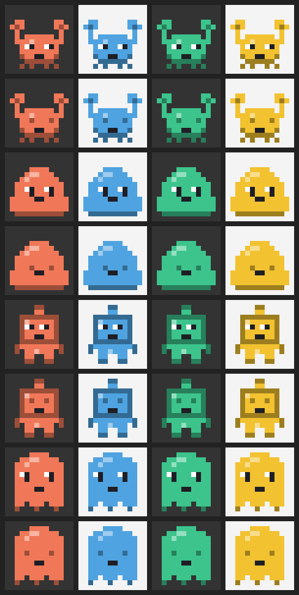
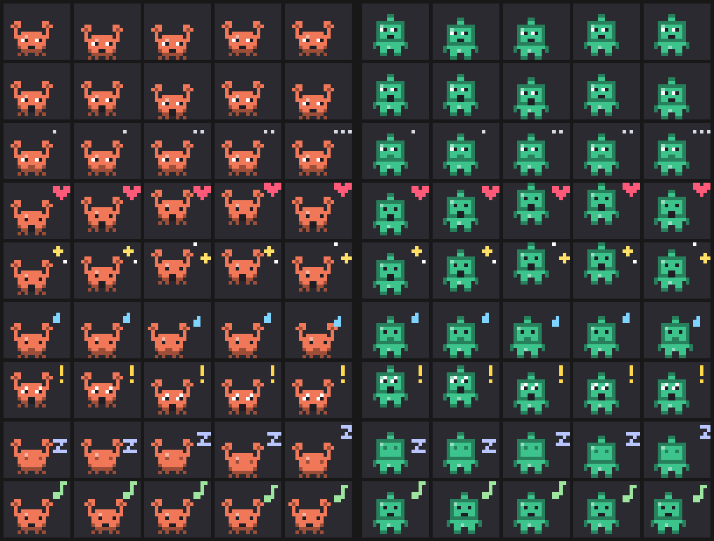

<p align="center">
  
</p>

<h1 align="center">Pixel Buddies</h1>

<p align="center">
  A tiny animated pixel-art companion with its own personality, living above your prompt in Claude Code.<br>
  Pick a type, a colour and a name. It reacts to your work, cheers your wins, sulks at errors, and thinks out loud.
</p>

<p align="center">
  <a href="https://github.com/karthikkay07/pixel-buddies/actions/workflows/ci.yml"></a>
  <a href="https://github.com/karthikkay07/pixel-buddies/releases"></a>
  <a href="LICENSE"></a>
</p>

<p align="center">
  <a href="#install">Install</a> ·
  <a href="#usage">Usage</a> ·
  <a href="#personalities">Personalities</a> ·
  <a href="#settings">Settings</a> ·
  <a href="#how-it-works">How it works</a> ·
  <a href="#development">Development</a> ·
  <a href="CHANGELOG.md">Changelog</a>
</p>

---

## Features

- **Buddy studio:** run `/buddy` to design a buddy: **type**, **colour**, **name** and **personality**, with a live preview of every animation.
- **A personality from its name:** "Captain Bolt" talks like a pirate, "Sleepy Mochi" yawns a lot, "Sprocket" quotes documentation. There are 8 archetypes, and you can reroll one or pick it yourself.
- **Reacts to your work:**
  - perks up when you send a prompt
  - bobs along while Claude works
  - celebrates passing tests and successful builds
  - wobbles sadly at errors
  - stretches after a long job
- **Random thoughts:** between tasks it thinks out loud ("💭 If a function is never called, does it truly exist?"), paced by its personality and your chattiness setting.
- **Falls asleep when you're away** (Zzz…) and wakes up when you're back.
- **9 animations:** idle, typing, thinking, happy, celebrate, sad, surprised, sleeping and wave, with floating effects (hearts, sparkles, sweat drops, Zzz, !).
- **Real pixel art everywhere:** half-block cells repainted 8 times a second in the terminal, and a self-animating SVG in the Claude desktop app.
- **Private and offline:** no network calls and no model calls. Every line your buddy says is written into the mod, and nothing about your code leaves your machine.
- **Robust:** saved data is checked when it loads, and the buddy can never block a prompt or a tool call.

### The cast

| Types and colours | Animations |
|---|---|
| <br>Crab, Blob, Robot, Ghost<br>Coral, Sky, Mint, Sunny, Grape, Rose, Slate |  |

## Install

You need a build of [Claude Code](https://claude.com/claude-code) that supports mods (function-hook plugins). Pixel Buddies is tested on **2.1.295** and **2.1.303**. Mods are an early-access feature, so if `/plugin install` doesn't recognise the `--marketplace` flag, update Claude Code first.

From the prompt of a Claude Code terminal session, run:

```
/plugin install pixel-buddies --marketplace karthikkay07/pixel-buddies
```

1. Answer **`y`** to *Add marketplace?* (source `github:karthikkay07/pixel-buddies`).
2. Choose a scope. **User** (the default) turns Pixel Buddies on in every session.
3. Pick your settings (or keep the defaults).
4. You'll see `Installed pixel-buddies. Plugin is now active.` and a "No buddy yet. **Make one**" line above your prompt.

> **Claude desktop app:** `/plugin install` runs in a terminal session. Once it's installed at the user scope, Pixel Buddies also loads in the desktop app's Code tab and draws there as an animated SVG.

### Update

```bash
claude plugin update pixel-buddies
```

Then run `/reload-plugins` in any open session, or start a new one. Buddies made with 0.1 keep everything and get a personality read from their name.

### Uninstall

```bash
claude plugin uninstall pixel-buddies
```

## Usage

| Command | What it does |
|---|---|
| `/buddy` | Opens the **Buddy studio** panel |
| `/buddy poke` | Pokes your buddy. It always reacts. |
| `/buddy hide` | Hides your buddy (it's remembered) |
| `/buddy show` | Brings it back |

### In the studio

| Control | Key | Action |
|---|---|---|
| **Type** picker | arrows + Enter | Crab, Blob, Robot or Ghost |
| **Colour** picker | arrows + Enter | Seven colours |
| **Name** field | type, Enter to save | Up to 24 characters. Left empty, a name is picked for you. |
| **Personality** picker | arrows + Enter | *Auto (from the name)*, or one of the 8 archetypes |
| **Reroll** | `p` | Rolls a different personality for an *Auto* buddy |
| **Preview** picker | arrows + Enter | Plays any of the 9 animations in the preview |
| **Save buddy / Save changes** | `s` | Saves and makes it your active buddy (it says hello) |
| **Save as new** | `n` | Keeps the current buddy and adds this design as a new one |
| **Surprise me** | `r` | Random type, colour, name and personality |
| **Use / Delete** | — | Manage your roster at the bottom of the panel |

The studio shows the personality as you type the name: its archetype, energy, chattiness, traits and a sample line. You can keep up to 50 buddies. Press **Esc** to close the studio.

## Personalities

| Archetype | Energy | Chatty | Traits | Names that suggest it |
|---|---|---|---|---|
| **Cheerleader** | ●●●●● | ●●●●○ | believes in you, loudly · celebrates every tiny win | Sunny, Joy, Sparkle, Star |
| **Grump** | ●●○○○ | ●●●○○ | unimpressed by everything · secretly cares a lot | Grumpy, Grim, Oscar, Rusty |
| **Philosopher** | ●○○○○ | ●●●○○ | ponders the nature of bugs · speaks in gentle riddles | Sage, Zen, Socrates, Owl |
| **Chaos gremlin** | ●●●●● | ●●●●● | wants to press the red button · chaotic but kind | Chaos, Gremlin, Zig, Boom |
| **Sleepy** | ●○○○○ | ●●○○○ | always five minutes from a nap · cosy | Sleepy, Mochi, Nap, Luna |
| **Nerd** | ●●●○○ | ●●●●○ | quotes documentation for fun · owns a label maker | Pixel, Bit, Sprocket, Ada |
| **Pirate** | ●●●●○ | ●●●●○ | calls bugs "scallywags" · arr | Captain, Jack, Salty, Anchor |
| **Poet** | ●●○○○ | ●●●○○ | speaks in tiny poems · dramatic about errors | Willow, Rose, Byron, Ivy |

With *Auto*, the first word of the name that matches a keyword decides ("Captain Bolt" is a pirate). Otherwise the name's hash picks one, so the same name always gives the same buddy. Energy and chattiness vary by ±1 between buddies of the same archetype.

### What your buddy reacts to

| When… | It… |
|---|---|
| a session starts, or you save or switch buddies | waves hello |
| you send a prompt | perks up (!) |
| Claude is working | bobs along, typing |
| a tool call fails | wobbles, with a sweat drop (at most once every 20 s) |
| tests pass or a build succeeds (in Bash output) | celebrates with sparkles |
| a turn that took 45 s or more finishes | hops happily (♥) |
| nothing happens for a while | thinks out loud (💭) |
| you're away past the sleep timer | falls asleep (Zzz) and wakes up when you're back |

## Settings

Change these from Claude Code's config menu (`/config` in a terminal session), or in `settings.json` under `pluginConfigs["pixel-buddies"].options`.

| Setting | Values | Default | Effect |
|---|---|---|---|
| `chattiness` | `silent` · `quiet` · `normal` · `chaotic` | `normal` | **silent**: animations only. **quiet**: speaks at big moments, thinks about every 10 min. **normal**: reacts to prompts sometimes, thinks every few minutes. **chaotic**: comments on nearly everything and thinks about every minute. |
| `sleepAfterMinutes` | number | `10` | Minutes without activity before your buddy dozes off. `0` keeps it awake. |

A buddy's own chattiness scales how often it thinks: a chaos gremlin muses two to three times as often as a sleepy buddy. Small remarks have a cooldown, so even a chaotic buddy doesn't flood the band.

## How it works

Pixel Buddies is a **mod**: a TypeScript hooks module that Claude Code loads in its own sandbox. It has no DOM, no Node and no network access.

| Piece | Mod API |
|---|---|
| `/buddy` command | `$.command.register` + a `command.run` hook |
| Studio panel | `$.ui.open` + a `ui.render` hook for `Pane`, using `Select`, `Input` and `Button` elements |
| Buddy above the prompt | a `ui.render` hook for `AbovePrompt` |
| Reactions | `prompt.submit`, `tool.call` (the result after `next`) and `turn.complete` hooks. Each has a pass-through `.catch`, so a buddy can never block your work. |
| Thoughts and sleep | a `$.clock.every` "brain" tick every 10 s |
| Terminal animation | a `Raster` element repainted in place by `$.ui.blit` every 125 ms |
| Desktop animation | an `Svg` element where each distinct frame is a group toggled by SMIL `<animate>`, so it needs no timers |
| Saved buddies | `$.store`, checked on load by [`hooks/data.ts`](hooks/data.ts) |
| Live state | `atom` / `read` / `update` over `$.state` (`mood`, `isAsleep`, …), so a change redraws whatever reads it |
| Settings | `userConfig` in `plugin.json`, read from `register(on, options)` |

Sprites are 12×12 strings in [`hooks/sprites.ts`](hooks/sprites.ts). Each letter is a role (`B` body, `D` shade, `L` highlight, `E` eye, `W` eye shine, `K` mouth), so one drawing works in every colour and every expression. An animation in [`hooks/animations.ts`](hooks/animations.ts) is a function from tick to **pose**: offset, eyes (`open`, `closed`, `happy`, `wide`, `sad`), mouth (`smile`, `open`, `flat`, `none`) and an effect. The renderer turns any pose of any sprite into pixels. Personalities, lines and reaction rules live in [`hooks/personality.ts`](hooks/personality.ts).

## Development

```bash
git clone https://github.com/karthikkay07/pixel-buddies
cd pixel-buddies
claude --plugin-dir .
```

The `--plugin-dir` flag hot-reloads the mod every time you save a file.

```bash
claude plugin validate .
```

```bash
claude plugin test .
```

`validate` checks the manifest, the marketplace file and the hooks module the way the engine will load them. `test` runs 29 tests in five suites:

| Suite | Covers |
|---|---|
| [`tests/buddy.test.tsx`](tests/buddy.test.tsx) | Sprite data, every animation × type in the terminal and as SVG, poses, and the studio → save → band flow on `terminal` and `desktop` |
| [`tests/personality.test.ts`](tests/personality.test.ts) | Lines for every archetype and event, name → personality, rerolls, chattiness levels, no-repeat lines, thought pacing, reading tool results |
| [`tests/mood.test.tsx`](tests/mood.test.tsx) | Hello on session start, poke, falling asleep and waking on the mock clock, silent mode |
| [`tests/lifecycle.test.tsx`](tests/lifecycle.test.tsx) | Restoring from a partly broken store, `/buddy hide` and `show`, switching, Save as new, Delete |
| [`tests/data.test.ts`](tests/data.test.ts) | Store checks, including upgrading 0.1 buddies |

[CI](.github/workflows/ci.yml) runs both commands on Ubuntu and Windows for every push and pull request, pinned to a known Claude Code version.

For editor type-checking, load the mod once (Claude Code writes its typings to `.claude-plugin/types/`), then run `tsc -p .`.

### Add a new buddy type

1. Draw a 12×12 sprite in `SPRITES` in `hooks/sprites.ts`, using the letters above. Mark eyes with `E` (and `W` for shine) and the mouth with `K`, so every expression works.
2. Add it to `KINDS` there and to `BuddyKind` in `types/index.d.ts`.
3. Run `claude plugin test .`. The tests draw every animation for it.

### Add a personality

1. Add an entry to `ARCHETYPES` in `hooks/personality.ts`: label, energy, chattiness, three traits, name keywords, and lines for each event (`{name}`, `{tool}` and `{time}` are filled in).
2. Add it to `Archetype` in `types/index.d.ts`.
3. Run `claude plugin test .`. The tests check every event has lines and that they're short enough.

### Layout

```
.claude-plugin/
  plugin.json        manifest and settings (userConfig)
  marketplace.json   makes this repo installable with /plugin install
hooks/
  hooks.json         points at register.tsx
  register.tsx       commands, studio, band, reactions, brain and paint timers
  personality.ts     archetypes, lines, name → personality, reaction rules
  animations.ts      the 9 animations as tick → pose
  sprites.ts         pixel data, palette, effects, Raster and SVG encoders
  data.ts            checks for saved data
types/index.d.ts     the mod's $.state contract
tests/               claude plugin test suites
.github/workflows/   CI: validate + test on Ubuntu and Windows
assets/              README images
```

## Roadmap

- **v0.3:** accessories (hats, glasses, headphones), eye styles, patterns, a custom hex colour, new types (cat, dragon, cactus)
- **v0.4 (opt-in AI):** a richer personality written by Claude when you create a buddy, `/buddy ask`, rate-limited live quips. Only the buddy's profile and an event label are ever sent.
- **v1.0:** memory and stats ("Day 12 together!"), an optional "speak through Claude" mode, sounds

Issues and pull requests are welcome.

## License

[MIT](LICENSE) © karthikkay07. Pixel Buddies is an independent community project and isn't affiliated with Anthropic.
